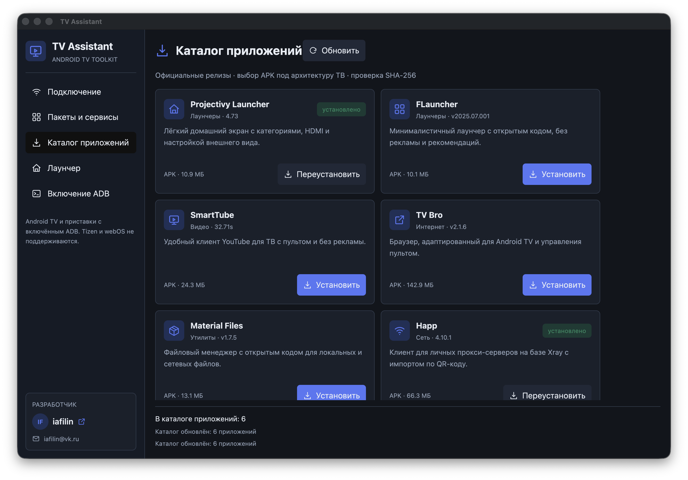

# TV Assistant

[](https://github.com/iafilin/tv-assistant/actions/workflows/release.yml)

Настольное приложение на **Rust + GPUI** для управления Android TV и ТВ-приставками по Wi-Fi через ADB. Без root, без командной строки для основных операций и без обязательного подключения по USB.



## Возможности

- Поиск ADB-устройств в локальной сети, в том числе при включённом VPN.
- Подключение к телевизору по IP и порту `5555`.
- Автоматическая загрузка официального Android Platform Tools при отсутствии ADB на компьютере.
- Информация об устройстве, Android, архитектуре и текущем лаунчере.
- Список установленных пакетов и работающих процессов.
- Отключение ненужных пакетов только для `user 0` и их восстановление.
- Защита настроек, клавиатуры, системных служб и текущего лаунчера от случайного отключения.
- Установка Projectivy Launcher с проверкой SHA-256 и подтверждением системного Home.
- Каталог приложений с актуальными версиями из официальных релизов и выбором APK под архитектуру ТВ.
- Русский интерфейс с локальными SVG-иконками.

Поддерживаются **Android TV и ТВ-приставки с включённым ADB**. Tizen и webOS не поддерживаются.

## Скачать

Актуальные сборки публикуются автоматически после обновления ветки `main`:

**[Скачать последнюю версию](https://github.com/iafilin/tv-assistant/releases/latest)**

| Платформа | Файл |
|---|---|
| macOS, Apple Silicon и Intel | `TV-Assistant-macOS-universal.zip` |
| Windows x64 | `TV-Assistant-Windows-x64.zip` |

### Установка на macOS

1. Распакуйте ZIP и перенесите `TV Assistant.app` в `/Applications`.
2. При первом запуске откройте приложение через контекстное меню **Открыть → Открыть**.
3. Сборка подписана локально, но не нотаризована Apple. Если macOS блокирует запуск, проверьте источник файла и выполните:

```bash
xattr -dr com.apple.quarantine "/Applications/TV Assistant.app"
```

### Установка на Windows

1. Распакуйте ZIP в отдельную папку.
2. Запустите `tv-assistant.exe`.
3. Если SmartScreen показывает предупреждение, нажмите **Подробнее → Выполнить в любом случае**. Сборка не имеет коммерческой цифровой подписи.

## Подключение телевизора

1. Откройте **Настройки → О телевизоре** и несколько раз нажмите на **Номер сборки**, чтобы открыть параметры разработчика.
2. Включите **Отладка по USB**, **ADB по сети** или **Сетевую отладку**.
3. Подключите компьютер и ТВ к одной сети Wi-Fi.
4. Укажите IP телевизора в TV Assistant и нажмите **Подключиться**.
5. Подтвердите запрос отладки на экране телевизора.

Если производитель убрал переключатель ADB, на некоторых CVTE/Яндекс ТВ работает комбинация: на главном экране зажмите `Menu` на 1–2 секунды, затем быстро нажмите **Влево → Вверх → Влево → Вверх → Назад**. В инженерном меню включите только ADB.

**Не изменяйте** `Panel Type`, `LVDS`, `White Balance`, `Backlight` и `Shipping Init`.

После завершения работы рекомендуется выключить ADB на телевизоре.

## Каталог приложений

- Projectivy Launcher
- FLauncher
- SmartTube
- TV Bro
- Material Files
- Happ

Версии, размеры и ссылки на APK загружаются из официальных GitHub-релизов разработчиков. Перед установкой проверяется SHA-256. Поддерживаются `arm64-v8a` и `armeabi-v7a`.

## Запуск из исходников

Требуется актуальный stable Rust.

```bash
git clone https://github.com/iafilin/tv-assistant.git
cd tv-assistant
cargo run --release
```

Полезные команды:

```bash
# Найти ADB-устройства
cargo run -- --scan

# Прочитать устройство
cargo run -- --inspect 192.168.0.100

# Открыть пакеты или каталог
cargo run -- --connect 192.168.0.100
cargo run -- --catalog-view 192.168.0.100

# Получить каталог без установки приложений
cargo run -- --catalog 192.168.0.100

# Отключить или восстановить пакет
cargo run -- --disable 192.168.0.100 com.example.package
cargo run -- --restore 192.168.0.100 com.example.package
```

## Автоматические сборки

GitHub Actions собирает проект для macOS universal (`arm64` + `x86_64`) и Windows x64. После каждого push в `main` публикуется prerelease `v0.1.N` с ZIP-файлами. Pull request запускает сборку без публикации релиза.

## Безопасность

- Не используется root.
- Пакеты отключаются только для текущего пользователя Android.
- Системные компоненты защищены в коде приложения.
- Старый лаунчер не удаляется автоматически при установке Projectivy.
- APK загружаются только из официальных источников, с проверкой хеша, если он опубликован разработчиком.

## Разработчик

**iafilin**

- VK: [vk.ru/iafilin](https://vk.ru/iafilin)
- Почта для связи: [iafilin@vk.ru](mailto:iafilin@vk.ru)
